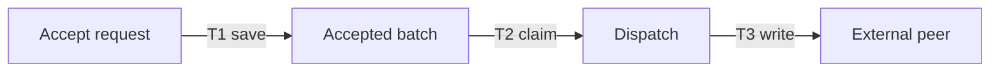
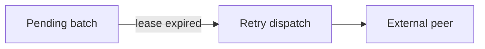

# Author named Mermaid views

Use one `mermaid` fence for a single view. Use a four-backtick `mermaid-tabs` fence when readers need to switch between related scenarios, such as normal processing and recovery. Each view contains a unique plain `##` title, exactly one nonempty three-backtick `mermaid` fence immediately after that title, then optional explanatory Markdown. The first view is selected initially. Switching tabs changes the diagram, legend and explanation together; only the active view is rendered.

`````markdown
````mermaid-tabs
## Acceptance and dispatch

Acceptance commits durable work before network dispatch begins.

1. **T1 · Accept.** Store the request and target batches in one transaction.
2. **T2 · Claim.** Record a lease, then release the database transaction.
3. **T3 · Dispatch.** Write to the peer and record the outcome.

> Acceptance acknowledges durable responsibility; it does not prove remote receipt.

## Recovery

The stored batch survives disconnection. An expired lease permits another worker to resume it.
````
`````

Keep view titles plain text and unique without regard to case. Explanatory subsections can use `###` or deeper headings; `##` starts the next view. Do not nest Mermaid blocks in the explanation. Top-level ordered lists become responsive explanatory columns. Paragraphs, links, code, lists, tables and blockquotes retain the embedding reader's Markdown policy, asset resolution and reference-link templates. View headings stay inside the outer fence and do not become document-outline entries. Invalid view structure produces a localized authoring error, without partially displaying a broken group.

## Node semantics and icons

| Authored class | Meaning | Presentation |
| --- | --- | --- |
| `mo-persistent` | Durable state whose persistence matters in this view | Success-colored boundary and tinted fill |
| `mo-process` | Processing or coordination | Info-colored boundary and tinted fill |
| `mo-external` | An external participant or boundary | Dashed neutral boundary |

Assign at most one of these classes to a node, using `:::mo-persistent` or a Mermaid `class` statement. The viewer generates a localized legend from roles actually used by the active diagram. Colors follow Monica's active palette in light and dark modes; hover and keyboard focus highlight the node. Prefer these classes over authored fixed `classDef` colors. Do not infer durable state from a CLR type or an Entity icon: the diagram's meaning belongs to the author.

Hosts provide Building Block identity and kind icons through `MermaidNodes: IReadOnlyDictionary<string, MoMermaidNode>` on `MoMarkdown`, `MoMudMarkdown`, `MoMarkdownMermaidBlock` or `MoMarkdownMermaidViews`. Keys use `[A-Za-z][A-Za-z0-9_]*`. Reuse the same alias for the same part across views. `MoMermaidNode(Label, Icon?, Kind?)` accepts an optional trusted 24-unit SVG body from `MoIcons`, never SVG read from authored content. Rectangular nodes show a small icon inside their upper-left padding; other Mermaid shapes keep their geometry and kind tooltip. Icons identify kind, while semantic classes identify the role in that scenario. Neither is a second graph model.

The host owns the alias-to-domain mapping and activation callback; Markdown cannot supply executable callbacks, icon URLs or SVG. Keep Mermaid in strict mode. Navigation, focus, theme refresh, local runtime loading and immersive reading follow [the shared Markdown contract](markdown.md). Consumers do not need a custom tab implementation or JavaScript controller.
